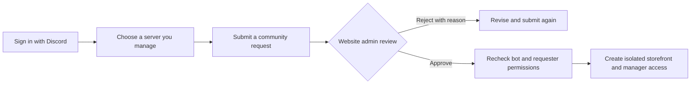

<div align="center">
  
  <h1>Verdanta · Discord Community Platform</h1>
  <p><strong>A home for your community. A storefront built around trust.</strong></p>
  <p>Server-specific perks, manual payment review, and community management in one web application.</p>
  <p>
    
    
    
    
  </p>
  <p>
    <a href="#quick-start">Quick start</a> ·
    <a href="#how-it-works">How it works</a> ·
    <a href="MULTI_SERVER.md">Operations guide</a> ·
    <a href="PLAN.md">Roadmap</a> ·
    <a href="CONTRIBUTING.md">Contributing</a>
  </p>
  
  <p><sub>Nature-inspired branding with motion-aware video playback. <a href="public/MEDIA-LICENSE.md">Media attribution and usage terms</a>.</sub></p>
</div>

---

## Why this project exists

Discord communities often sell perks through disconnected messages, payment screenshots, and manual role changes. Verdanta brings that process into a traceable workflow while keeping payment verification in the hands of trusted staff.

This is a separate successor to **Discord-Package**, expanded from one community into a platform with isolated storefronts and website-approved server onboarding. Vercel is the deployment target; no verified public deployment URL is listed yet.

## What you can do

<table>
  <tr><th>For members</th><th>For community managers</th><th>For website administrators</th></tr>
  <tr>
    <td>Sign in with Discord, browse perks, apply a coupon, and pay through UPI.</td>
    <td>Manage products, prices, role rewards, colors, payment details, and staff.</td>
    <td>Review community requests and approve or reject onboarding.</td>
  </tr>
  <tr>
    <td>Submit a UTR and payment screenshot, then track review and delivery separately.</td>
    <td>Review payment evidence and retry unsuccessful Discord role delivery.</td>
    <td>Inspect community configuration, bot access, and recorded administrative actions.</td>
  </tr>
</table>

- **Separate communities:** products, coupons, orders, payment evidence, staff, and settings are scoped to a server.
- **Approval-based onboarding:** Discord owners and users with Administrator or Manage Server permission submit requests; website administrators decide whether to register them.
- **Custom presentation:** per-community colors, Discord banners, named community cards, custom dropdowns, and a server selector.
- **Recoverable delivery:** manual payment approval is saved before Discord role assignment; delivery failures remain visible and can be retried.
- **Accessible motion:** the default forest banner uses WebM/MP4 with a poster, pause controls, and reduced-motion handling.

## How it works

### Connect a community



Requests do not publish a storefront. Approval validates the bot and the requester's current Discord permissions, then saves the community, settings, access grant, decision, and audit together. Duplicate pending requests and competing reviews are rejected. The bot must already be installed before approval; bot-install access remains restricted to website administrators and legacy registrars.

### Purchase a perk

1. Choose a product and optionally apply one coupon.
2. Pay the displayed amount using the generated UPI link or QR code.
3. Submit the UTR and payment screenshot.
4. Authorized staff manually approve or reject the evidence.
5. After approval, the application attempts to grant the configured Discord role.

**Payments are never automatically verified.** An approved payment and a delivered role are distinct states. Staff fulfill benefits that are not implemented by the application.

<details>
<summary><strong>Coupon rules and delivery limits</strong></summary>

- Percentage or fixed-rupee discounts; optionally limited to one product, a minimum price, and an expiry.
- One coupon per order. Codes are case-insensitive, reusable, and currently have no redemption limit.
- Prices use whole rupees. Percentage discounts round down and must leave at least ₹1 payable.
- Order creation rechecks the coupon and saves the price breakdown. Later coupon edits do not change existing orders.
- Only the configured Discord role is automatically delivered. Product duration does not yet trigger role expiry.
- The buyer must already belong to the Discord server. The bot requires Manage Roles and a role above the role being granted.

</details>

## Architecture

| Layer | Implementation | Responsibility |
| --- | --- | --- |
| Application | Next.js 15 App Router, React 19, TypeScript | Pages, route handlers, server context |
| Interface | Tailwind CSS 4, Framer Motion, custom UI components | Responsive storefront and administration |
| Identity | Auth.js v5 beta, Discord OAuth2 | Sign-in and encrypted server-discovery grants |
| Persistence | PostgreSQL, Prisma 5 | Communities, access, orders, coupons, audit, rate reservations |
| Discord | REST API v10 | Guild discovery, permission checks, metadata, role assignment |
| Payments | Manual UPI workflow | QR generation, evidence submission, staff review |
| Verification | Vitest, TypeScript, Next.js build | Unit and database integration checks |

One shared bot serves multiple communities. There is no continuously running Gateway client. Database-backed rate reservations coordinate Discord API calls across application instances.

<details>
<summary><strong>Repository map</strong></summary>

```text
app/                  Pages and HTTP route handlers
components/           Storefront, checkout, community and admin interfaces
config/               Default content and legacy configuration
lib/auth/             Website administrator identity helpers
lib/servers/          Tenant access, discovery, requests and credential encryption
lib/discord/          Discord metadata, request coordination and role helpers
lib/orders/           Order persistence and recoverable delivery
lib/coupons/          Discount calculation and validation
prisma/               Schema and versioned migrations
scripts/              Local database, migration import and integration helpers
public/               Branding and licensed banner assets
tests/               Unit and isolated database integration tests
```

The default storefront is `/`; registered storefronts use `/s/{internalId}`. Management uses `/servers` and `/servers/{internalId}`. Discord Guild IDs are unique authoritative identities; internal IDs are used in website routes. Server names are display labels and need not be unique.

</details>

## Quick start

Use **Node.js 22 LTS**, npm, and a PostgreSQL database. Install versions from the committed lockfile with `npm ci`. The optional Windows database helper expects PowerShell 7 and PostgreSQL 18 at the path documented in its script.

```bash
git clone https://github.com/Me-FoxXY/Discord-Community-Platform.git
cd Discord-Community-Platform
npm ci
```

Copy `.env.example` to `.env` (`Copy-Item .env.example .env` in PowerShell, or `cp .env.example .env` on macOS/Linux). Fill in the values below before using real Discord sign-in.

| Variable | Purpose |
| --- | --- |
| `DATABASE_URL` | PostgreSQL connection string |
| `AUTH_SECRET` | Strong random Auth.js session secret |
| `AUTH_URL` | Canonical website origin; locally `http://localhost:3000` |
| `AUTH_DISCORD_ID` / `AUTH_DISCORD_SECRET` | Discord OAuth application credentials |
| `DISCORD_BOT_TOKEN` | Server-only token for the shared bot |
| `CONFIG_ENCRYPTION_KEY` | 32 random bytes encoded as 64 hexadecimal characters |
| `ADMIN_DISCORD_IDS` | Comma-separated trusted website administrator IDs; global access |

Generate secrets locally and save them privately:

```bash
node -e "console.log(require('node:crypto').randomBytes(32).toString('base64url'))"
node -e "console.log(require('node:crypto').randomBytes(32).toString('hex'))"
```

Use the first value for `AUTH_SECRET` and the second for `CONFIG_ENCRYPTION_KEY`. Never commit either value.

On a **new, empty database**:

```bash
npm run db:migrate
npm run dev
```

Open [localhost:3000](http://localhost:3000). Configure the exact OAuth callback `http://localhost:3000/api/auth/callback/discord` in the Discord Developer Portal, and the equivalent HTTPS callback for deployment. Login requests `identify guilds`; reconnect when a saved grant expires or predates guild discovery.

Then open **My servers → Request a community**. Website administrators review requests in **Review queue**. Approved managers configure their storefront, payment details, products, role IDs, and appearance through the website.

<details>
<summary><strong>Windows local database and development login</strong></summary>

Run `npm run db:local` to initialize/start the isolated PostgreSQL instance on `127.0.0.1:55432`. It sets only `DATABASE_URL` in `.env`; database files and generated credentials stay in ignored `.local/`. Run `npm run db:migrate` afterwards. Stop it with `npm run db:local:stop`.

Dev login is available only under `npm run dev`. It does not represent a real Discord account and cannot discover real guilds or receive roles. Use real Discord sign-in for onboarding and delivery tests. Never assign the development identity production privileges.

</details>

<details>
<summary><strong>Upgrading the original community</strong></summary>

Read [MULTI_SERVER.md](MULTI_SERVER.md) before upgrading existing data. Back up and verify restoration before applying migrations. The legacy `DISCORD_GUILD_ID`, `DISCORD_ROLE_*`, and `NEXT_PUBLIC_*` community variables are import inputs, not the configuration mechanism for newly registered servers.

Run `node scripts/import-server.mjs` only after reviewing the migration/import instructions and original role mappings. For older databases created using `db push`, reconcile the baseline before deploying migrations; do not apply baseline CREATE TABLE statements over existing tables.

</details>

## Development and verification

| Command | Use |
| --- | --- |
| `npm run dev` | Local development server |
| `npm test` | Fast unit tests with mocked dependencies |
| `npm run typecheck` | Strict TypeScript validation |
| `npm run test:integration` | Migrations and database integration tests on the isolated local test database |
| `npm run build` | Generate Prisma client and production build; no database migrations |
| `npm start` | Serve a completed production build |
| `npm run db:migrate` | Apply committed migrations |
| `npm run db:studio` | Inspect the configured development database |

The integration runner currently depends on the Windows local database helper and its ignored password file. It targets `discord_community_test`, never the application's `.env` database. Authentication and Discord calls are simulated. Real OAuth, bot installation, role delivery, and hosted recovery still require live checks.

GitHub Actions runs unit tests, type checking, and a production build. Integration tests remain a separate local check. Build-time Google Font downloads require network access. A dedicated ESLint setup is not currently configured.

## Security and deployment

- Backend checks enforce server-specific permissions; hiding controls is not an authorization boundary.
- Website administrator access is separate from Discord management permissions.
- OAuth grants are encrypted server-side; the shared bot token stays in deployment secrets.
- Payment proof is private and served through authenticated routes. It currently resides in PostgreSQL, not object storage.
- Decisions and delivery use conditional writes, transactions, leases, and explicit retries.
- Existing communities remain connected when the request-approval migration is applied.

Deploy to **Vercel with hosted PostgreSQL**, not static GitHub Pages. Configure environment secrets, database pooling and backups, apply migrations as a separate controlled deployment step, then build. Keep development login disabled in production. See [the operations guide](MULTI_SERVER.md) for access rules, key rotation, timezone migrations, recovery and launch checks; see [SECURITY.md](SECURITY.md) for reporting guidance.

## Current boundaries and next steps

<details open>
<summary><strong>Implemented foundations; remaining production work</strong></summary>

**Implemented:** multi-community data isolation, request/review onboarding, custom catalogs and themes, coupons, manual payment review, role delivery retries, audit records, encrypted discovery grants, and coordinated Discord rate limiting.

**Still planned:** membership renewal/expiry, scheduled delivery workers, private object storage, OAuth refresh, richer operational monitoring, and multiple bot identities if justified. The request list currently returns the newest 100 records; pagination is a follow-up before larger deployments.

Do not sell automated benefits that the application cannot fulfill. There is no claim of production certification, universal test coverage, or a completed live deployment.

</details>

## Contributing and credits

See [CONTRIBUTING.md](CONTRIBUTING.md) for the branch workflow and review checklist. Keep payments manually verified and preserve existing orders during changes. Future features should use a separate, descriptive branch after the current PR is opened.

Built by [Me-FoxXY](https://github.com/Me-FoxXY). The nature footage is attributed separately in [public/MEDIA-LICENSE.md](public/MEDIA-LICENSE.md). No software license has been selected for this repository; public visibility alone does not grant redistribution rights. Dependency and media licenses remain separate.
